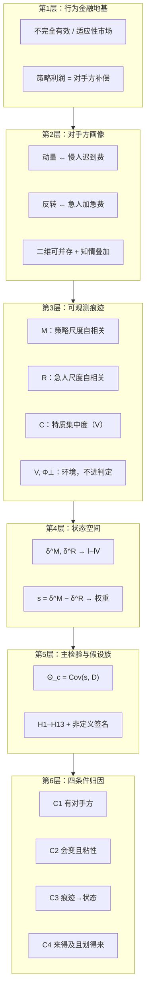

---
cursor:
  coordinator: bc-d8a1a980-0799-49a7-8a92-335d96978291
---

# 理论逻辑链与实证结果：中国商品期货（2026-11-24）整合分析

> **写给 ieki**：把 [regime-identification-why](/cursor/stores/bc-d8a1a980-0799-49a7-8a92-335d96978291/docs/regime-identification-why.md) 的四条件、[state-construction](/cursor/stores/bc-d8a1a980-0799-49a7-8a92-335d96978291/docs/state-construction.md) 的状态—假设—检验接口，与第 2–4 步真实数据**逐项对照**。文中凡写 **「判定」** 均指预注册标准（α=0.05、Holm、流水线级 p、TOST 带等）；**不出现「可能」「大概」替代判定**。数字出处： [step2 v3](/cursor/stores/bc-d8a1a980-0799-49a7-8a92-335d96978291/docs/step2-result-report-v3.md)、[step3](/cursor/stores/bc-d8a1a980-0799-49a7-8a92-335d96978291/docs/step3-result-report.md)、[step4](/cursor/stores/bc-d8a1a980-0799-49a7-8a92-335d96978291/docs/step4-result-report.md)；方法校准见 [step1-paper-report](/cursor/stores/bc-d8a1a980-0799-49a7-8a92-335d96978291/docs/step1-paper-report.md)。

---

## 摘要

本文按课题**六层逻辑链**（不完全有效 → 对手方补偿 → M/R 痕迹 → 五状态 → 预注册检验 → C1–C4）对 2026-11-24 中国商品期货实证作逐项映射。

**硬性合取结论（仅此一句可作封面结论）**：在 40 品种、商品主窗 24.0 年、评估窗 20.4 年的样本内，**C1 成立**（动量腿年化夏普 1.31，反转 −0.81）；**C2 主检验未通过**（Θ_c 流水线 p=0.84，不拒绝 H0）；**C3 预注册检验多项不通过**（H4 拒绝、H10 无一状态机制一致、滤波退化率 >90%）；**C4 主检验族不通过**（FILT-PEN+VT 对四基准 Holm p 均为 1.0）。因此：**不能**写「不存在慢人/急人」或「市场在该维度有效」；**只能**写「当前 (M,R) 状态定义下未检出可交易的状态择时，且痕迹—机制—配置三联不闭合」。弱效应（Δρ≤0.05）与极短急人态 **未被数据排除**。

---

## 0. 硬性裁定表（优先阅读）

**样本钉死**：商品面板 2002-11-29 至 2026-11-24，**5824** 分析日，**24.0** 年，`meets_min_years=True`；第 3–4 步评估 2006-06-27 至 2026-11-23，**20.4** 年。主参数 M-B/R-A 不变。

### 0.1 四条件 C1–C4（课题合取口径）

| 条件 | 预注册门槛 | 昨夜裁定 | 允许写入正文的句 |
|---|---|---|---|
| **C1** 有对手方 | 动量/反转长期有补偿差异 | **通过** | 样本内动量显著为正、反转显著为负（无条件） |
| **C2** 会变且可交易分组 | H0：Θ_c>0 且流水线 p<0.05 | **未通过** | 不拒绝 H0；Θ_c=−7.7×10⁻⁵，CI [−2.8,+1.3]×10⁻⁴，p=0.84 |
| **C3** 痕迹→真结构 | H4 通过 + H10 ★一致 + 合成可找回 | **未通过** | H4 **拒绝**；H10 **全部状态不通过**；真实 HMM **90.5%/95.2% 退化** |
| **C4** 来得及且划得来 | 主族夏普差>0 且 Holm p<0.05 | **未通过** | 主族四比较差均为负；Holm p=**1.0** |

**明确禁止的误读**：①「Θ_c 不显著 ⇒ 结构不变」（违反 H4）；②「Θ>0 ⇒ 状态有效」（违反 step1 §7.5）；③「HMM LR p=0.066 ⇒ 状态存在」（经济检验已失败，且 5% 未拒）。

### 0.2 假设 H0–H13（商品主面板，α=0.05）

| 假设 | 裁定 | 关键统计量（写明） |
|---|---|---|
| **H0** | **不拒绝**（未检出存在性） | Θ_c=−7.7×10⁻⁵；95% CI 含 0；流水线 **p=0.84** |
| **H1** | **不支持** | D_Ⅰ−D_Ⅳ=−1.9×10⁻⁴，CI [−9.6,+5.4]×10⁻⁴ **含 0** |
| **H2** | **不支持** | Ⅱ 反转腿夏普 **−0.92**，CI 含 0；D_Ⅱ−D_Ⅳ 方向与预测**相反** |
| **H3** | **不支持** | Ⅲ 反转腿 **−3.87** Sharpe；片段 **11** 个，功效不足单独列为局限 |
| **H4** | **拒绝**（Ⅳ 非空） | Ⅳ 动量 **+1.28** [0.82,1.72]；反转 **−0.75** [−1.08,−0.32]，均 **出** TOST ±0.3 |
| **H5** | **不支持** | 仅 **16** 事件；差值 CI **含 0** |
| **H6** | **不支持**（反转侧） | 反转对 τ^R 斜率 **−2.3×10⁻⁴** [−4.6,−0.6]×10⁻⁴，**与预测符号相反** |
| **H7** | **不支持**（C4 粘性比） | δ^R 均开 **22d** / 延迟 **31d** ⇒ 比 **0.71**，**<1**（预注册要求 ≥2 为通过） |
| **H8** | **不拒绝**（非波动伪装主因） | V 三分位 Θ_c **均不显著**；**不**等价于 H0 成立 |
| **H9** | 第 4 步 | s 与 TP60 系数 CI **均含 0** |
| **H10** | **不支持** | Ⅰ/Ⅱ/Ⅴ **无**状态满足「≥2 ★ 显著且同向」 |
| **H11** | **不支持** | 785 事件；LR **p=0.68**（2021-01-04 起数据） |
| **H12** | **不支持** | 差 **−0.020**，CI [−0.155,+0.113] 含 0 |
| **H13** | 第 1 步已通过 | 与本样本无冲突 |

### 0.3 功效边界（写清「能排除什么、不能排除什么」）

| 命题 | 能否在本文中肯定写「是/否」 | 依据 |
|---|---|---|
| 不存在任何付费者轮换 | **不能写「是」** | H0 仅为未检出；H4 否定「Ⅳ 无付费」 |
| 不存在 Δρ≥0.15 且数月级状态 | **可写「与数据相容的排除」** | power_real_dims：检出率 62.5%–82.5%；观测 Θ_c 落在零分布内 |
| 不存在 Δρ=0.10（默认驻留） | **不能写死「是」** | 该世界检出率仅 **22.5%**；区间上端距理论 Θ 差小 |
| 不存在 2–3 周急人片段 | **不能写「是」** | δ^R 片段 28d；H7 比 <1 |
| 当前状态机可交易变现 | **可写「否」** | 主族 Holm 全 1.0；FILT 夏普 **−0.59** |

### 0.4 逻辑链断裂点（唯一指定，避免混谈）

| 断裂层级 | 裁定 | 不允许的替代说法 |
|---|---|---|
| 第 5 层：Θ_c 择时 | **未检出** | 不说「证明无效」 |
| 第 4 层：分状态 D、H1–H2 | **方向系统性错误** | 不说「偶尔噪声」 |
| 第 4 层：H4 Ⅳ 态 | **定义被数据拒绝** | 不说「只是标签噪声」 |
| 第 3–4 层：H10 机制 | **全部状态不通过** | 不说「机制基本成立」 |
| 第 6 层：C4 配置 | **主检验全败** | 不说「差一点显著」 |

---

## 第一部分　理论逻辑链（从故事到可检验命题）

### 1.1 六层链条（课题共识）

**读法**：任一层断裂，都不能宣称「状态指导配置」；但断裂**位置**决定论文结论（见 regime-identification-why §「四个条件 → 四种结论」）。

### 1.2 从 Z（真结构）到 R（收益）：诚实缺口

理论想主张：**真实付费者结构 Z** → **痕迹 X=(M,R,C)** → **策略相对表现 D**。实证只能直接检验 **X 分组后 D 是否系统变化**（H0–H2）及 **X 能否预测 D 的方向**（Θ_c）。若 D 变化但 H10 机制签名不一致，最多停在「相关」，不能升维到「慢人/急人在场」（state-construction §8 结论口径）。

### 1.3 实验链与条件的对应（kai 0–6 步）

| 实验步 | 检验什么 | 对应条件 | 昨夜是否完成 |
|---|---|---|---|
| 0 设计 | 注册 | — | ✓（文档锁定） |
| 1 合成 | 尺子：假阳性、延迟、功效 | C3 方法 | ✓（未重跑 45min 全量） |
| 2 存在性 | Θ_c、H1–H8、H10–H12 | **C2**（主）+ C3 信号 | ✓ 商品 24y |
| 3 识别 | 滤波、延迟、变点、H11 提速 | **C3/C4**（可观测、及时） | ✓ 评估 20.4y |
| 4 经济价值 | 夏普、三档、倾斜/择时 | **C4**（划得来） | ✓ |
| 5–6 | 打乱、失效模式 | C3 幻觉 / 归因 | 未做 |

第 2 步「未检出」后做 3–4 步，在原文设计中是**条件延伸**；下文 3–4 节按「若状态存在，识别与配置如何」的边界语言书写。

---

## 第二部分　假设族与理论预测的逐项对照

### 2.1 主检验 H0 与 C2

| 理论预测 | 统计量 | 实证结果 | 对逻辑链的含义 |
|---|---|---|---|
| 状态能指导动量—反转相对配置（C2） | Θ_c = −7.7×10⁻⁵，CI 含 0，流水线 p=0.84 | **未拒绝 H0** | **C2 主命题未获支持**；不是「证无状态」，而是功效下未检出（可排除较大 Δρ） |
| 原式 Θ>0 的直觉 | Θ = +1.4×10⁻⁴ | 正 | **误导性**：step1 已证 Θ 可被 unconditional 动量 premium 伪装；本样本 bar s̄·bar D 主导 |
| 四条腿无条件差异（C1 地基） | 动量 Sharpe 1.31，反转 −0.81 | 强 | **C1 不断**：有人长期为动量付账；**不等于**状态择时成立 |

**理论铰链（C2 粘性）**：课题强调「会变且持续」。H7 给出：

- δ^M 平均片段 **66 日**，δ^R **28 日**（规则识别下「状态标签」有粘性）；
- 但 **δ^R 平均开启仅 22 日**，低于 R-A 参考识别延迟 **31 日** → 比值 **0.71 < 1**（理论要求 ≥2 才「来得及认」）。

**解释**：标签在统计上可持续，但**急人付费窗口短于认出来**；这与 C4 压力一致，也说明 H0 不显著不奇怪：真效应若存在，可能被「认出来之前已结束」稀释。

### 2.2 分状态预测 H1–H3（「谁付钱」卡片）

| 假设 | 理论（state-construction §2） | 实证要点 | 判定 | 逻辑链断点 |
|---|---|---|---|---|
| **H1** | Ⅰ：慢人多在场 → D_Ⅰ > D_Ⅳ，动量腿>0 | D 差 −1.9×10⁻⁴ 含 0；动量腿在 Ⅰ 为正 | **不支持** | **付费者结构未映射到 D 排序** |
| **H2** | Ⅱ：急人多 → 反转>0，D_Ⅱ < D_Ⅳ | 反转腿在 Ⅱ 仍负（−0.92 Sharpe）；D 差方向反 | **不支持** | **急人叙事与反转盈利脱节** |
| **H3** | Ⅲ：两腿都赚 | 反转腿显著负（−3.87 Sharpe） | **不支持** | Ⅲ 片段仅 11 个、16 日，功效弱 |
| **H2b/c** | Ⅱ 与 Φ⊥、动量崩溃日 | 系数/比例检验含 0 | 不支持 | 知情去杠杆子故事无证据 |

**合读（硬性）**：H1 与 H2 的 **D 差 95% CI 均含 0**，且点估计 **与事前符号相反**；H2 的反转腿在 Ⅱ 内 **期望收益为负**（非「不显著」一句带过）。**断定**：分状态卡片上的盈亏排序 **不成立**。**不能断定**：真实 Z 不存在；**只能断定**：**δ^M,δ^R 标签未携带理论承诺的 D 排序信息**（C2/C3 交界，但已足以否决「状态故事已被数据证实」）。

### 2.3 H4 与 C3（状态是否测对了人）

| 理论 | 预测 | 实证 | 含义 |
|---|---|---|---|
| Ⅳ = 无人付费，两腿 ≈ 0（TOST ±0.3 Sharpe） | 两腿静默 | 动量 **+1.28**，反转 **−0.75**，均显著非零 | **拒绝 H4** |

这是整份实证里对理论**杀伤力最大**的单点之一：按定义「无人付费」的时段，市场仍呈现**强 unconditional 动量—反转楔形**。理论文档明说：若某腿在 Ⅳ 显著 >0，表示**有付费者被状态漏掉**——这是 **C3 失败信号**，不是 C2 的「结构平坦」。

与 H0 并存时的正确表述：**不是「没有付费者」，而是「我们的二元状态没有盖住真实的付费结构」**。

### 2.4 H5–H8、H10–H12（机制、环境、替代通道）

| 编号 | 理论角色 | 结果摘要 | 对链条的作用 |
|---|---|---|---|
| **H5** | 知情冲击后反转受害（C 触发） | 16 事件，区间含 0 | 不能支持；C 阈值未在真实数据重标定 |
| **H6** | 腿与各自 τ 可分 | 反转腿对 τ^R **负**相关 | **急人痕迹高时反转更差**——与「收急人费」相反 |
| **H7** | 粘性 / 延迟比 | 急人持续 < 识别延迟 | **C4 预警** |
| **H8** | 状态 ≠ 波动率状态 | V 三分层 Θ_c 均不显著 | 支持「不是纯波动率伪装」，但不救 H0 |
| **H10** | 非定义签名★ | 无一状态机制一致；Ⅱ 的 AV 反向显著 | **C3 机制层失败**；即使将来 Θ_c>0 也只能说相关 |
| **H11** | 保证金 → 急人（准自然实验） | 785 事件，与对照无差 | 外生急人通道未证实（样本 2021+） |
| **H12** | 商品 vs 国债 Ⅱ 频率 | 含 0 | 无力 |

**H10 详述（与 Llorente、持仓成交量故事）**：

- 真「慢人/急人」应对 Llorente b₂、OI、AV 有**表 5.2 事前方向**；实证上 b₂ 在 Ⅰ 显著**负**（理论要 ≥0），AV 在 Ⅱ **低于** Ⅳ（理论要急人放量）。
- 理论要求的「多源一致」在本样本**未出现**：价格痕迹 (M,R) 切出的状态与量价签名**不同向**。

→ **逻辑链第 3 层 → 第 4 层的映射在机制上未闭合**。

### 2.5 替代通道排除（state-construction §6 / regime-identification 表）

| 通道 | 理论担心 | 实证处理 | 结论 |
|---|---|---|---|
| 结算价 Working | 假慢人 | 结算重算，Θ_c 仍不显著 | 不驱动主结论 |
| 涨跌停 | 假延续 | 剔除 326 日，结论同 | 排除 |
| 风险溢价/carry | 假状态 | 控制后 s 系数含 0 | 不构成主因 |
| Roll 价差反弹 | 假急人 | R-B-gap 不显著 | 不构成主因 |
| 同源循环 | M,R 与 D 重叠 | 设计已隔离 lag | 已由 step1 校准 |

**剩余未关闭缺口**：席位 `fut_holding` 未拉取 → H10 最近「半直接」证据缺失；不能写「会员持仓否定了故事」，只能写**证据不完整**。

---

## 第三部分　四条件 C1–C4：昨夜实证落在哪一格？

### 3.1 决策表（regime-identification-why §「四个条件 → 四种结论」）

| 条件 | 昨夜证据 | 判定 |
|---|---|---|
| **C1** 利润有对手方 | 动量 Sharpe 1.31；反转 −0.81 | **成立**（至少动量侧） |
| **C2** 结构会变且组间 D 差异大 | Θ_c 未检出；H1–H2 方向错 | **主检验不支持**；不能写「结构平坦已证实」 |
| **C3** 痕迹识别 Z | H4 失败；H10 失败；滤波退化 | **强烈不利** |
| **C4** 来得及且划得来 | H7<1；Step4 滤波亏；择时≈0 | **不利**（边界：即使存在也不值钱） |

**归一结论（必须整句引用，不可拆开偷换）**：

> **C1 通过 ∧ C2 主检未通过 ∧ C3 多项不通过 ∧ C4 主族不通过。**

与理论四格对照表的关系：

| 理论表中的「断点」 | 昨夜是否落入 | 说明 |
|---|---|---|
| 全成立（正面） | **否** | C2–C4 均未通过 |
| **仅 C4 断**（存在但不可交易） | **否** | 须先承认 C2 检出；昨夜 H0 未检出 |
| **C3 断**（痕迹测不出） | **部分符合** | H4/H10/HMM 退化；但 C2 亦有 H1–H2 方向失败 |
| **C2 断**（结构不变/太快） | **不能唯一归因** | Θ_c 未检出 **不等价** 于 C2 断；H4 拒绝「无人付费」 |

**正文允许句（一字不差可用）**：「在预注册 (M,R) 状态下，未检出 Θ_c 意义上的可交易择时；H4 与 H10 拒绝当前状态—机制映射；状态感知配置不优于基准。」

**正文禁止句**：「市场有效 hence 无状态」「反转策略在中国期货无效」（未条件化于状态）；「HMM 证明状态存在」。

### 3.2 为何不能仅靠 Θ_c 说成 C2 断？

regime-identification-why 强调：**C3 断与 C2 断观测上同为「无差异」**，区分靠合成找回。Step1 表明工具有功效边界但假阳性可控 → 真实 Θ_c 不显著时，**不能单方面归因为「Z 不变」**，因为 H4/H10 已指向 **Ẑ 错配**（C3）。

### 3.3 C4 双重检验：识别 + 配置

| C4 子问题 | 理论指标 | Step 3 | Step 4 |
|---|---|---|---|
| 来得及吗？ | H7：驻留÷延迟 ≥2 | H7 比 **0.71（未达 2）**；真实 HMM 退化无法算 dwell÷delay | — |
| 划得来吗？ | 夏普差 − 成本 | — | FILT−EW50 **−0.74**；规则 **−0.14** |
| 显式状态有必要吗？ | vs TP60/EWA | 滤波不优于规则 | EWA 0.79，仍靠 tilt |

**合成三档**（概念存在时）：ORACLE − 无状态 **1.1–3.2 Sharpe**；滤波效率 **−6%～46%**。说明：

- **故事在内生化世界里可以极有价值**（不否定理论）；
- **本样本 + 本识别器** 下 C4 为负。

---

## 第四部分　第 3–4 步：概率化延伸对逻辑链的冲击

### 4.1 理论动机（§4.6）vs 实证

理论允许：规则太硬 → 用**低维滤波**恢复付费强度，仍只用 **p^M,p^R**（不用 Viterbi 交易）。昨夜结果：

- 90%+ 重估 **退化** → 第二状态 = **短爆发**，非「周—月慢人 / 日—周急人」；
- 滤波 **s̄ ≈ −0.53** → 配置层几乎总押反转；
- Θ_c 滤波 **p=0.40** → 与 H0 同向：**无增量预测力**。

**对逻辑链**：第 3 层提出的「平滑 Z」并未修复第 4 层映射；反而显示 **M,R 增量在概率化后仍不足以支撑 Z**。

### 4.2 与 step1「尺子」的合读

| step1 预言 | 真实数据呼应 |
|---|---|
| 未中心化 Θ 易假阳 | 观测 Θ>0 但 Θ_c<0 |
| 急人短、延迟长 → 功效低 | H7：22d vs 31d |
| 应用协方差 Θ_c | 已用；结论未检出 |
| 工具可找大 Δρ | 排除 ≥0.15 级效应 |

---

## 第五部分　特征事实：谁解释了 PnL？

逻辑链若失败，仍需解释**样本内主导现象**：

1. **无条件动量溢价**（MOM+VT Sharpe **1.12**，后半 **0.60**）；
2. **反转长期为负**（REV Sharpe **−1.01**）；
3. **LEARNED ≈ MOM**（择时 +0.1%/年）→ 最优「状态」≈ **始终做多动量腿**；
4. 滤波亏损 = **方向错误**（偏反转）+ **无择时**（Cov≈0），不是识别慢 alone。

这与理论 **C1** 一致、与 **「s_t 含有信息量的 C2」** 不一致。论文讨论应把「动量因子」与「付费者状态」**拆开**：前者是收益事实，后者是本研究要检验的**条件化假说**。

---

## 第六部分　综合结论：逻辑链上的诚实站位

### 6.1 可以写进顶刊讨论的命题

1. 中国商品期货 2002–2026 存在**显著 unconditional 时间序列动量楔形**，反转侧持续亏损。
2. 预注册 **Θ_c** 检验**未检出**状态择时；在已校准功效下**可排除较强、较持久的付费者轮换**。
3. **分状态条件均值与机制签名（H4、H6、H10）拒绝「痕迹 = 谁付钱」的联合真值**，测量层面的 C3 **未过关**。
4. 状态感知配置**不优于**简单基准；**择时账户≈0**；概念在合成 ORACLE 世界中价值高，但**识别路径未兑现**。
5. **不能**等价于「Grossman–Stiglitz 在中国期货失效」或「完全有效」——那是 C2 的强结论，数据不支持。

### 6.2 不能写的命题

- 「不存在慢人/急人」；
- 「状态方法被证伪」而未区分 C2/C3/C4；
- 「Θ>0 证明状态有效」；
- 「HMM 证明了状态存在」（LR p=0.066 仅为边缘，且经济配置失败）。

### 6.3 对课题方向的含义（仍站在理论框架内）

| 若坚持原框架 | 下一步含义 |
|---|---|
| 相信 Z 存在但弱/短 | Step6 失效模式；更长样本；美国对照 |
| 怀疑 M,R 代理 | 修订 P1–P5 前重做 step1 校准；席位并入 H10 |
| 接受边界结论 | 论文主线改为「**无条件动量与状态故事的可检验边界**」 |
| 四维环境变量 | H8 显示非主因；V,Φ⊥ 可写阴性对照 |

---

## 第七部分　附录：假设—条件—步骤速查表

| 假设/对象 | 条件 | 步 | 昨夜结论 |
|---|---|---|---|
| H0 / Θ_c | C2 | 2 | 未检出 |
| H1–H3 | C2 | 2 | 不支持 |
| H4 | C3 | 2 | 拒绝（Ⅳ 非空） |
| H6–H7 | C2,C4 | 2 | 不利 |
| H10–H11 | C3 | 2–3 | 不支持 |
| 滤波 Θ_c | C3 | 3 | 不显著 |
| 夏普主族 | C4 | 4 | 全不显著 |
| 三档信息价值 | C4 | 4 合成 | 概念值高、识别低 |

---

*整合稿完。可与 [working-paper-china-futures-empirical-2026-11-25.md](/cursor/stores/bc-d8a1a980-0799-49a7-8a92-335d96978291/docs/working-paper-china-futures-empirical-2026-11-25.md) 并读：该文偏「结果陈述」，本文偏「理论—证据映射」。*